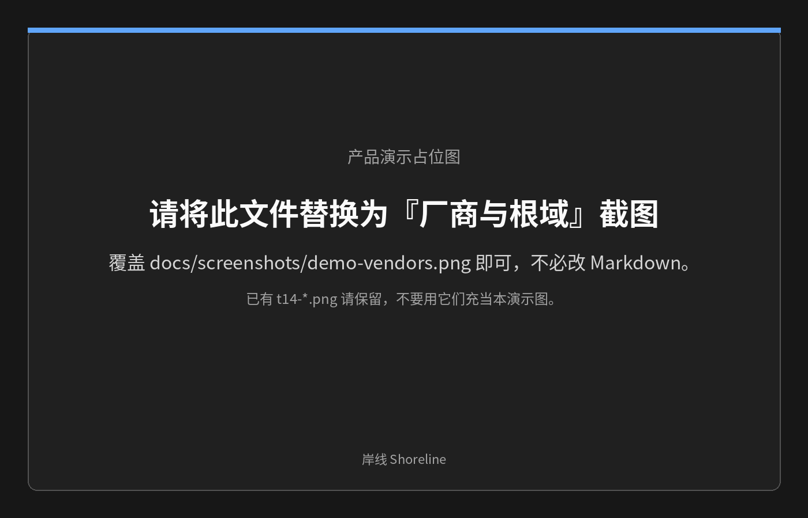
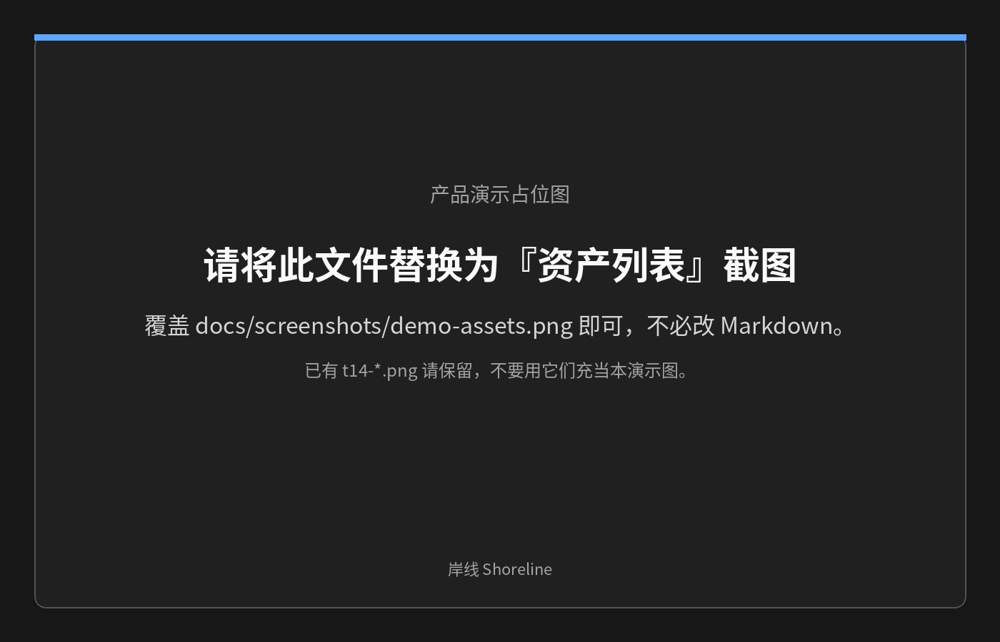
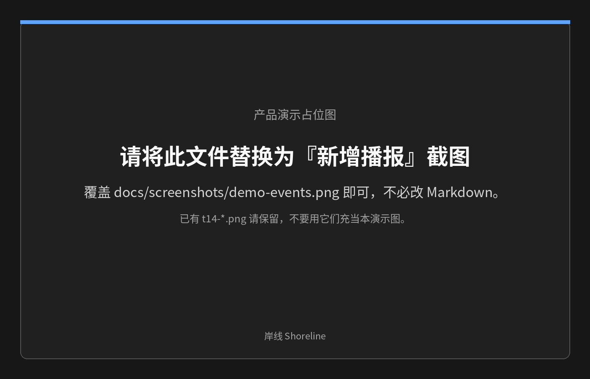

# 岸线 Shoreline

岸线帮你持续盯住 SRC 厂商的资产变化：按「厂商 → 根域」收集子域名和可访问的业务 URL，定时复扫后只播报新增和恢复，不用每次从头扫一遍。范围规则和客户托管排除用来判断该不该看；REST / OpenAPI / MCP 让 agent 可以查询、认领任务并在挖完后回写。只做发现与监控，不做攻击。MIT 许可。

Shoreline watches SRC vendor assets and reports only new and recovered findings; discovery and monitoring, no attacks.

## 功能要点

- 厂商 → 根域配置
- 子域名与可访问 URL 发现
- 新增 / 恢复播报
- 范围与客户托管排除
- REST / OpenAPI / MCP
- 挖掘认领与回写
- Web 管理端

## 技术栈

后端 Go，前端 React + Vite + Ant Design；PostgreSQL 持久化，Valkey + Asynq 做任务队列，被动 / DNS / HTTP 分类限速，大根域按片扫描、重启只重跑未完成分片。列表在 10 万级模拟子域下单次查询低于 1 秒。单机 Docker Compose 即可启动，对外提供 REST（OpenAPI）和 MCP。

## 产品演示



*厂商与根域*



*资产列表*



*新增播报*

## 一分钟本地起

```bash
cp .env.example .env   # 填入 API_BOOTSTRAP_TOKEN
docker compose up --build -d
```

Web：`http://127.0.0.1:5173`　·　API：`http://127.0.0.1:8080`

公网 VPS、反代、Certstream、ICP 见 [部署指南](docs/DEPLOY.md)。

> ⚠️ **升级注意（T28，迁移 016_drop_ips）：删除 `assets.ips` 列并抹掉历史播报里的 IP，「不可逆，先备份」。** 升级前按 [docs/DEPLOY.md「9. 备份与升级」](docs/DEPLOY.md#9-备份与升级) 用 `pg_dump -Fc` 备份；回退只能靠旧镜像 + `pg_restore`。

## 文档

- 部署：[docs/DEPLOY.md](docs/DEPLOY.md)
- 配置与接口：[docs/REFERENCE.md](docs/REFERENCE.md)
- Agent：[docs/AGENT_GUIDE.md](docs/AGENT_GUIDE.md)

## 开发

规格见 [`SPEC.md`](SPEC.md)，任务进度见 [`TASKS.md`](TASKS.md)。欢迎阅读 [`CONTRIBUTING.md`](CONTRIBUTING.md) 与 [`SECURITY.md`](SECURITY.md)。
